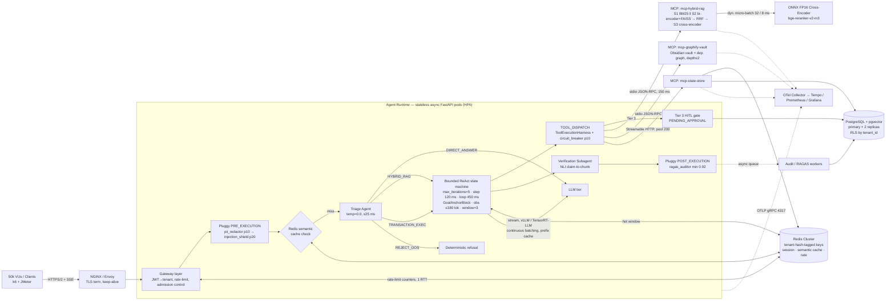

# design.md — The Unreliable Assistant → "Reliable Assistant" v1

> **Status:** DRAFT-FOR-LOCK (Gate 1). No application code may be written until this file is reviewed and tagged `design-locked`.
> **Source of truth:** *Hackathon Mid-Check Enterprise Blueprint v2* (Gates 0–18, 36 KPIs). Where this file and the blueprint disagree, the blueprint wins; deliberate deviations and blueprint inconsistencies are listed in Appendix B.
> **Stack (Gate 0):** Python 3.11 · FastAPI/Uvicorn (async) · MCP (JSON-RPC 2.0; stdio local, Streamable HTTP/SSE distributed) · Pluggy lifecycle hooks · Rank-BM25 (Okapi + Porter) + FAISS (HNSW) + `bge-large-en-v1.5` (ONNX) · ONNX Runtime `bge-reranker-v2-m3` FP16 · PostgreSQL+pgvector · Redis Cluster · Obsidian vault + Graphify · OpenTelemetry (OTLP 4317 → Prometheus/Tempo/Grafana) · k6 + JMeter · Streamlit workbench.

**Problems inherited and the section that fixes each**

| Legacy defect | Root cause (assumed from the brief) | Fix |
|---|---|---|
| Hallucinated facts | Single-keyword retrieval, fragmented chunks, ungrounded generation, no faithfulness gate | §1.2.2–1.2.3 3-stage RAG, abstention short-circuit (<0.42), `ragas_auditor`, KPI-10–13, KPI-20–24 |
| Runaway tool loops | Unbounded ReAct; brittle schema validation (`SKU99` vs `SKU-099`) retried forever | §1.2.6 `ToolExecutionHarness`, §1.7 ADR-4, `circuit_breaker`, KPI-14–17 |
| Cross-user cache leaks | Global / non-tenant cache keys | §1.7 ADR-3, KPI-28 |
| Context drift | Unbounded history, tool-output noise, no pinning | `GoalAnchorBlock`, observation compression, sliding window + `session_facts` (§1.3 step 7), KPI-18, KPI-26 |
| Latency collapse | Sync I/O, unbatched inference, no backpressure or timeouts | §1.4, §1.6, bulkheads, KPI-31–36 |
| Governance gaps (injection, obfuscated PII, no HITL) | No pre-hooks, no approval gate | §1.1 HITL rule, Appendix A plugins, KPI-01–03, KPI-19 |

**Assumption flagged for review:** the 200–600 ms target is defined as **end-to-end response latency of a grounded answer** (request received → final response/`final` event emitted) for the short answers used in the load test (≤ ~150 tokens; see KPI-31–33), which implies a fast LLM tier. **TTFT** is gated separately (KPI-25 ≤ 180 ms). Long generations are out of scope for the 450/600 ms gates. If the owner requires long-form completion within 600 ms, the LLM tier and answer length must be re-scoped and this document re-opened.

---

## 1.1 System Charter & Hard Boundaries

### Scope (in)
1. Grounded question answering over tenant-owned knowledge (documents, SOPs, product catalogs as atomic Obsidian notes, code repositories) with mandatory citations.
2. Tiered tool use via MCP: `TIER_1_READ` (retrieval, graph expansion, state read), `TIER_2_COMPUTE` (validation, calculation), `TIER_3_MUTATE` (form submission, workflow transitions) — Tier 3 is **always** behind an asynchronous HITL gate.
3. Multi-tenant, multi-user session continuity with auditable, hash-chained persistence.
4. Deterministic, hot-swappable safety and observability through lifecycle plugins, decoupled from LLM reasoning.

### Non-goals (out)
| # | Non-goal | Enforcement |
|---|---|---|
| NG-1 | **No autonomous clinical, financial, or legal execution without HITL.** The system may *inform*; any state-mutating action (Tier 3) writes `PENDING_APPROVAL` and pauses until an authorized reviewer approves. | RBAC tier check in `ToolExecutionHarness`; Execution Subagent freezes on Tier 3; default for unknown tools = deny. |
| NG-2 | No cross-tenant data sharing or cross-tenant model-context mixing. | ADR-3, KPI-28. |
| NG-3 | No training on tenant data. | Provider config `zero_retention=true`. |
| NG-4 | No unbounded agent autonomy (no self-spawned agents, no self-modifying tool lists, no recursive self-calls without state mutation). | ADR-4, hard caps. |
| NG-5 | No answers without evidence: if the top cross-encoder score is < 0.42 the system abstains deterministically (no LLM call). | §1.2.3 abstention short-circuit; KPI-23. |
| NG-6 | No raw PII reaching the LLM provider, logs, caches, or persistence (incl. obfuscated forms such as `name[at]domain`). | `pii_redactor`, fail-closed; KPI-02. |
| NG-7 | No unsigned MCP servers. | Signed MCP server manifests verified at startup (Gate 13). |

### HITL rule
The triage classifier tags `risk_tier`; domains `clinical | financial | legal` get an informational disclaimer prefix. Any request that implies an action (e.g. "approve this payment", "adjust dose") is a Tier 3 call: the Execution Subagent writes a `PENDING_APPROVAL` record to Postgres, returns `hitl_ticket_id`, and the action is **never executed** until an authorized reviewer approves via UI/API (Streamlit Tab 1 queue). KPI-19 requires 100 % enforcement.

### Personas
| Persona | Needs | Constraint |
|---|---|---|
| **End User (Analyst/Clinician-support/Support agent)** | Fast, cited answers | Sees only own tenant's/ACL's data |
| **Tenant Admin** | Manage corpora, ACLs, retention | Cannot read other tenants |
| **HITL Reviewer** | Approve/reject Tier 3 requests with full context | Approves only within own tenant and domain scope |
| **Compliance Auditor** | Replay any answer: query, evidence, tool calls, scores | Read-only access to audit log |
| **Platform SRE** | Operate at 50k VUs, meet SLOs | No access to tenant content, only redacted telemetry |
| **Plugin Developer** | Add hooks without touching the LLM loop | Plugins sandboxed by stage contract |

---

## 1.2 MCP Tool & Data Contracts

All MCP traffic is JSON-RPC 2.0 (stdio for local workers, Streamable HTTP/SSE for distributed services). Host = FastAPI app using `mcp.ClientSession`. Every request carries `_meta: {tenant_id, user_id_hash, request_id, trace_id, deadline_ms, idempotency_key}`; servers **must** reject calls lacking `_meta.tenant_id` (`-32011`) and must honor `deadline_ms` (cooperative cancel). MCP client JSON-RPC serialization overhead budget: p95 ≤ 4 ms (KPI-30). Default per-call MCP timeout: 150 ms (`mcp_config.json`).

### 1.2.1 Shared constrained types (Pydantic v2)

```python
from typing import Annotated, Literal
from uuid import UUID
from pydantic import BaseModel, ConfigDict, Field, StringConstraints as SC

TenantId   = Annotated[str, SC(pattern=r"^[a-z0-9][a-z0-9-]{2,31}$")]
UserHash   = Annotated[str, SC(pattern=r"^[a-f0-9]{32}$")]            # truncated HMAC-SHA256 of user id
SessionId  = Annotated[str, SC(pattern=r"^[0-9A-HJKMNP-TV-Z]{26}$")]   # ULID
RequestId  = Annotated[str, SC(pattern=r"^[0-9A-HJKMNP-TV-Z]{26}$")]
ChunkId    = Annotated[str, SC(pattern=r"^[a-z0-9-]{3,32}:[A-Za-z0-9_.-]{1,64}:\d{1,6}$")]  # tenant:doc:ordinal
ChunkHash  = Annotated[str, SC(pattern=r"^[a-f0-9]{64}$")]            # dedup key in RRF
NoteSlug   = Annotated[str, SC(pattern=r"^[\w\-./ ]{1,200}$")]         # vault note path, no '..' (validator rejects)
QueryText  = Annotated[str, SC(min_length=1, max_length=4000, strip_whitespace=True)]
SkuId      = Annotated[str, SC(pattern=r"^SKU-\d{3,6}$")]              # canonical form; auto-repair target
LotId      = Annotated[str, SC(pattern=r"^LOT-\d{5}$")]                # canonical form; auto-repair target

class Strict(BaseModel):
    model_config = ConfigDict(extra="forbid", frozen=True, str_strip_whitespace=True)

class Meta(Strict):
    tenant_id: TenantId
    user_id_hash: UserHash
    request_id: RequestId
    trace_id: Annotated[str, SC(pattern=r"^[a-f0-9]{32}$")]            # W3C traceparent trace-id
    deadline_ms: Annotated[int, Field(ge=10, le=2000)]
    idempotency_key: UUID                                              # UUIDv4, enforced by harness

class Citation(Strict):
    chunk_id: ChunkId
    uri: Annotated[str, SC(pattern=r"^rag://chunks/[A-Za-z0-9:_.-]+$")]
    quote_span: tuple[int, int]
```

### 1.2.2 Tool: `hybrid_retrieve` (server `mcp-hybrid-rag`) — Stages 1, 2 and RRF

Stage 1 BM25Okapi + PorterStemmer + inverted index (`k1=1.25`, `b=0.75`, `top_k=50`, pre-tokenized, < 12 ms). Stage 2 bi-encoder `bge-large-en-v1.5` (ONNX) + FAISS HNSW (`efSearch=64`, `top_k=50`, < 25 ms), chunks of 512 tokens with 64-token overlap. Fusion by Reciprocal Rank Fusion (`k=60`), dedup by `chunk_hash`, pool = 40 (< 3 ms).

```python
class HybridRetrieveIn(Strict):
    meta: Meta
    query: QueryText
    sparse_top_k: Annotated[int, Field(ge=1, le=100)] = 50
    dense_top_k: Annotated[int, Field(ge=1, le=100)] = 50
    bm25_k1: Annotated[float, Field(ge=0.5, le=2.5)] = 1.25   # Streamlit Tab 2 slider
    bm25_b: Annotated[float, Field(ge=0, le=1)] = 0.75        # Streamlit Tab 2 slider
    rrf_k: Annotated[int, Field(ge=1, le=200)] = 60           # ADR-1
    pool: Annotated[int, Field(ge=1, le=100)] = 40
    filters: dict[Annotated[str, SC(pattern=r"^[a-z_]{1,32}$")], str | int | bool] = {}
    # filters can only NARROW the ACL, never widen it.

class RetrievedChunk(Strict):
    chunk_id: ChunkId
    chunk_hash: ChunkHash
    text: Annotated[str, Field(max_length=3000)]
    bm25_score: float | None
    cosine_score: float | None
    rrf_score: float
    source_uri: str
    acl_fingerprint: Annotated[str, SC(pattern=r"^[a-f0-9]{16}$")]

class HybridRetrieveOut(Strict):
    chunks: Annotated[list[RetrievedChunk], Field(max_length=40)]   # RRF pool
    bm25_ms: float; dense_ms: float; rrf_ms: float
    degraded: Literal["none", "dense_only", "sparse_only"] = "none"
```

MCP descriptor:
```json
{"name":"hybrid_retrieve","description":"Tenant-scoped BM25 + bi-encoder retrieval fused with RRF. Read-only.",
"inputSchema":{"$ref":"#/$defs/HybridRetrieveIn"},"outputSchema":{"$ref":"#/$defs/HybridRetrieveOut"},
"annotations":{"readOnlyHint":true,"idempotentHint":true,"openWorldHint":false,"risk":"low","tier":"TIER_1_READ"}}
```
Resource template: `rag://chunks/{id}` → `ReadResourceResult` with `mimeType: text/markdown`; ACL checked per read.

### 1.2.3 Tool: `rerank` — Stage 3 cross-encoder (ONNX; MCP-wrapped for uniform auditing)

`bge-reranker-v2-m3`, ONNX FP16, batch 32, `max_len=512`, `rerank_k=4`, sigmoid threshold > 0.42, < 45 ms.

```python
class RerankIn(Strict):
    meta: Meta
    query: QueryText
    candidates: Annotated[list[RetrievedChunk], Field(min_length=1, max_length=40)]
    rerank_k: Annotated[int, Field(ge=1, le=8)] = 4
    threshold: Annotated[float, Field(ge=0, le=1)] = 0.42      # Streamlit Tab 2 slider; incident runbook may raise to 0.55
class RerankOut(Strict):
    ranked: list[tuple[ChunkId, float]]          # sorted desc, only scores > threshold, len <= rerank_k
    top_score: float
    abstain: bool                                # True when top_score < threshold -> deterministic abstention
    precision: Literal["fp16"]
    degraded: bool = False                        # True = fell back to rrf_score order (FMEA #2)
```

**Deterministic abstention short-circuit (Gate 9):** if `top_score < threshold`, the orchestrator bypasses LLM generation and emits a fixed abstention response in < 90 ms (zero hallucination risk, ~80 % token savings on those queries).

### 1.2.4 Tool: `graphify_expand` (server `mcp-graphify-vault`)

`graphify build ./src ./knowledge_vault --output graph.json` produces the unified dependency graph (Python modules, Pydantic schemas, Obsidian policy nodes). At runtime the server resolves the query anchor node and traverses **at most depth 2** over `[[wikilinks]]`/dependency edges, injecting only the minimal connected subgraph (~320 tokens vs ~1,400 raw chunk dump).

```python
class GraphifyExpandIn(Strict):
    meta: Meta
    seeds: Annotated[list[NoteSlug | ChunkId], Field(min_length=1, max_length=8)]
    hops: Annotated[int, Field(ge=1, le=2)] = 2
    token_budget: Annotated[int, Field(ge=200, le=2000)] = 320
    edge_types: list[Literal["wikilink", "import", "call", "backlink"]] = ["wikilink", "import"]
class GraphifyExpandOut(Strict):
    nodes: list[dict]            # {id, summary(<=240 tok), edge_from, hop, risk_tier, version}
    tokens_used: int
    tokens_saved_vs_raw: int
```
Vault notes are atomic Markdown with strict YAML frontmatter (`id`, `domain`, `risk_tier`, `version`) and explicit `[[wikilinks]]` to related rules.

### 1.2.5 Tools: `state_get` / `state_put` / `audit_append` / `workflow_submit` (server `mcp-state-store`)

```python
class SessionFact(Strict):
    fact: Annotated[str, Field(max_length=300)]
    source_chunk_id: ChunkId
    verified: Literal[True] = True

class SessionState(Strict):                    # hot window (Redis/RAM) + durable facts (Postgres `session_facts`)
    session_id: SessionId
    turn_index: Annotated[int, Field(ge=0, le=500)]
    goal_anchor: "GoalAnchorBlock"
    last_turns: Annotated[list[dict], Field(max_length=3)]         # sliding window = last 3 ReAct turns
    schema_version: Literal[1] = 1

class GoalAnchorBlock(Strict):                 # immutable; prepended at index 0 of every ReAct prompt
    original_intent: QueryText
    normalized_entities: dict[str, str]        # e.g. {"sku": "SKU-099"}
    policy_constraints: Annotated[list[str], Field(max_length=10)]

class StatePutIn(Strict):
    meta: Meta; state: SessionState
    expected_version: int          # optimistic concurrency; mismatch -> -32021

class WorkflowSubmitIn(Strict):                # TIER_3_MUTATE; never executes directly
    meta: Meta
    workflow: Annotated[str, SC(pattern=r"^[a-z_]{3,48}$")]
    payload: dict
class WorkflowSubmitOut(Strict):
    status: Literal["PENDING_APPROVAL"]
    hitl_ticket_id: str

class AuditRecord(Strict):
    meta: Meta
    query_redacted: str
    evidence_ids: list[ChunkId]
    tool_calls: list[dict]
    answer_redacted: str
    faithfulness: float | None
    plugin_decisions: list[dict]
    prev_hash: Annotated[str, SC(pattern=r"^[a-f0-9]{64}$")]          # SHA-256(prev_hash + event_payload), tamper-evident
```
Postgres `session_facts` is keyed by `session_id` and carries `tenant_id` on every row; every query includes `tenant_id`.

### 1.2.6 Triage contract & `ToolExecutionHarness`

**Triage Agent** — front-door distilled classifier, `temperature=0.0`, p95 ≤ 25 ms:
```python
class TriageOut(Strict):
    intent: str; domain: Literal["general", "clinical", "financial", "legal", "inventory", "other"]
    risk_tier: Literal["TIER_1_READ", "TIER_2_COMPUTE", "TIER_3_MUTATE"]
    complexity: Literal["low", "medium", "high"]
    route: Literal["DIRECT_ANSWER", "HYBRID_RAG", "TRANSACTION_EXEC", "REJECT_OOS"]
```

**Every MCP tool call passes `ToolExecutionHarness`**, in order: (1) Pydantic v2 strict validation; (2) deterministic regex auto-repair (e.g. `SKU99` → `SKU-099`, `lot 44` → `LOT-00044`; repaired args re-validated, original preserved in audit); (3) RBAC tier check (`TIER_1_READ`, `TIER_2_COMPUTE`, `TIER_3_MUTATE`) against the subagent's grant; (4) `UUIDv4` idempotency-key enforcement (duplicate key → return stored result, never re-execute). KPI-14 (first-pass validity ≥ 96 %) and KPI-15 (auto-repair success ≥ 90 %).

### 1.2.7 Subagent topology (isolation rules)

| Subagent | Core responsibility | Bound MCP servers | Isolation & guardrail rule |
|---|---|---|---|
| **Retrieval** | Query rewriting, 3-stage hybrid RAG, citation grounding | `mcp-hybrid-rag`, `mcp-graphify-vault` | Read-only; cannot invoke state-mutating tools |
| **Execution** | Schema validation, form submission, workflow transitions | `mcp-state-store` | No RAG/external web access; Tier 3 triggers HITL freeze |
| **Verification** | Claim-to-chunk NLI check, RAGAS triad audit, OTel logging | `mcp-state-store` (audit log only) | Independent model context; vetoes ungrounded drafts |

(Gate 2 of the blueprint calls the third branch "Audit Subagent"; it is the same component — see Appendix B.)

### 1.2.8 Public API (FastAPI)

`POST /api/v1/agent/query` (JSON; the endpoint exercised by k6/JMeter) and `POST /api/v1/agent/stream` (SSE; used for TTFT, KPI-25). Auth: OIDC JWT → `tenant_id`, `user_id`. Body: `{session_id?, message: QueryText}`. A `tenant_id` in the body or `X-Tenant-ID` header is accepted **only as a consistency assertion** — it must equal the JWT claim, otherwise `-32011`; it is never the source of truth.

Response (JSON): `{answer, citations[], route, tenant_id, faithfulness, abstained, trace_id, hitl_ticket_id?}` — `tenant_id` echo and `faithfulness` (inline Verification-Subagent NLI score) are asserted by the load tests (§Appendix C). SSE events: `token`, `citation`, `tool_status`, `final {faithfulness, hitl_ticket_id?}`, `error {code,message,retryable}`.

### 1.2.9 Error codes

| Code | Name | Retryable | Meaning |
|---|---|---|---|
| -32700 | ParseError | no | JSON-RPC std |
| -32600 | InvalidRequest | no | JSON-RPC std |
| -32601 | MethodNotFound | no | Unknown/denied tool |
| -32602 | InvalidParams | no | Pydantic validation failed (after auto-repair attempt) |
| -32603 | InternalError | yes (1×) | Unhandled server fault |
| -32001 | DeadlineExceeded | yes (fallback) | `deadline_ms` / per-step timeout elapsed |
| -32002 | UpstreamUnavailable | yes | Dependency down |
| -32003 | RateLimited | yes (after `retry_after_ms`) | Tenant/user quota |
| -32011 | TenantMissing | no | `_meta.tenant_id` absent/invalid or mismatches JWT |
| -32012 | AclDenied | no | Chunk/note outside ACL, or RBAC tier denied |
| -32013 | PiiBlocked | no | Redactor failed closed |
| -32014 | InjectionBlocked | no | Shield verdict ≥ threshold |
| -32015 | HitlRequired | no | Tier 3 action awaiting human (`PENDING_APPROVAL`) |
| -32021 | VersionConflict | yes | State CAS mismatch |
| -32031 | LoopBudgetExceeded | no | `max_iterations=5` / 450 ms loop budget hit |
| -32032 | CircuitOpen | yes (later) | Breaker open (`HALTED_BREAKER`) for this `(tool, args-hash)` |
| -32041 | UngroundedAnswer | no | Cross-encoder top score < 0.42, faithfulness < 0.92, or no evidence → abstain |
| -32042 | ContextOverflow | no | Token budget breach after compression |
| -32051 | ReplayedIdempotencyKey | no | Duplicate UUIDv4 key; stored result returned |

---

## 1.3 Distributed Topology & Data Flow



**Bulkheads:** isolated pools per dependency — `rag_pool=64`, `db_pool=128`, `llm_pool=256` — so a slow reranker cannot starve health checks or triage routing.

### Request data flow (happy path, cache miss, `HYBRID_RAG`)
1. NGINX/Envoy → Gateway: verify JWT, derive `tenant_id`/`user_hash`, token-bucket check in Redis, admission control (shed at queue wait > 25 ms → 429 with `Retry-After`).
2. **PRE_EXECUTION** (`hook.pre`): `pii_redactor` (p10) → `injection_shield` (p20). Both fail-closed. p95 ≤ 15 ms (KPI-01).
3. **Semantic cache lookup** (`cache.lookup`) per ADR-3. Hit → skip to step 11.
4. **Triage** (`triage.classify`, ≤ 25 ms) → `(intent, domain, risk_tier, complexity)` → route. `REJECT_OOS` and `DIRECT_ANSWER` skip retrieval.
5. Build `GoalAnchorBlock` (original intent, normalized entity IDs after harness auto-repair, active policy constraints); load last-3-turn window from Redis (miss → Postgres replica `session_facts`).
6. Retrieval Subagent → `hybrid_retrieve` (BM25 ‖ dense → RRF pool 40) → `rerank` (top 4, threshold 0.42). If `top_score < 0.42`: **abstain deterministically** (< 90 ms), skip to step 11. Concurrently `graphify_expand` (depth ≤ 2).
7. Context assembler: `GoalAnchorBlock` at index 0, reranked evidence, graph subgraph (~320 tok); every tool observation compressed to ≤ 180 tokens by the extractive compressor; verified facts persisted to `session_facts`.
8. Bounded ReAct loop (`INIT → TRIAGE → REASONING → TOOL_CALL → OBSERVATION → VERIFY → DONE/HALTED`): ≤ 5 iterations, 120 ms/step, 450 ms total; every tool call passes `ToolExecutionHarness` then `circuit_breaker`. Tier 3 call → HITL gate → `PENDING_APPROVAL`, loop pauses.
9. LLM generates (`llm.generate`).
10. Verification Subagent: claim-to-chunk NLI check (inline, cheap) → `faithfulness`; ungrounded draft is vetoed → abstain (`-32041`).
11. Egress: response/stream `final` emitted; every sentence must map to a retrieved `chunk_id` else suppressed.
12. **POST_EXECUTION** (`hook.post.ragas`, async, off critical path): full RAGAS audit; `< 0.92` → answer flagged and record marked `needs_review`; audit row appended (hash-chained); semantic-cache write only if score ≥ 0.92.
13. `otel_exporter` spans emitted for every stage.

**Data-residency & isolation:** Postgres RLS (`USING tenant_id = current_setting('app.tenant_id')`); `tenant_id` in every SQL query and Redis key; FAISS shards per tenant tier; zero raw PII persisted; MCP server manifests signed.

---

## 1.4 End-to-End Latency Budget (200–600 ms)

**Metric:** client-observed end-to-end response latency at 50,000 concurrent VUs (cache-miss path): **p50 ≤ 240 ms, p95 ≤ 450 ms, p99 ≤ 590 ms (< 600 ms)** — KPI-31/32/33. Cache-hit path target p95 ≤ 120 ms; deterministic abstention ≤ 90 ms. TTFT p95 ≤ 180 ms (KPI-25).

| # | Stage / OTel span | p50 ms | **p95 budget ms** | **p99 budget ms** | Mechanism that makes it achievable |
|---|---|---|---|---|---|
| 1 | LB + TLS (resumed) + HTTP/2 + gateway (JWT, rate-limit) | 5 | 10 | 15 | Keep-alive, TLS 1.3 resumption, local JWKS cache, 1 pipelined Redis RTT |
| 2 | `hook.pre`: PII + injection | 8 | 15 | 22 | Regex/Aho-Corasick first pass + small ONNX classifier (CPU); KPI-01 |
| 3 | `cache.lookup` | 2 | 5 | 8 | Same-AZ Redis, single key probe |
| 4 | `triage.classify` | 12 | 25 | 32 | Distilled classifier, `temperature=0.0`; KPI-05 |
| 5 | Retrieval S1 ‖ S2 (`rag.bm25` ‖ `rag.dense`) | 15 | 25 | 35 | Parallel; BM25 ≤ 12 ms in-memory inverted index; embed + HNSW ≤ 25 ms; 150 ms hard MCP timeout |
| 6 | `rag.rrf` | 1 | 3 | 5 | Rank arithmetic only, pool 40 |
| 7 | `rag.rerank` (cross-encoder) | 25 | 45 | 60 | ONNX FP16, micro-batch 32 / 8 ms wait; KPI-09 |
| 8 | Graphify depth ≤ 2 (parallel with 7; excluded from sum unless slower) | 8 | 20 | 30 | Pre-built adjacency, in-memory LRU |
| 9 | Context assembly + observation compression | 5 | 10 | 15 | Extractive compressor, no LLM |
| 10 | `llm.generate` (short grounded answer, streamed) | 100 | 240 | 330 | vLLM/TensorRT-LLM, continuous batching, prefix caching, small fast tier |
| 11 | Verification NLI + citation check + egress flush | 6 | 15 | 25 | Small NLI model, string-match citation check |
| | **Sum (critical path)** | **177** | **393** | **547** | |
| | **Reserved headroom (jitter, GC, queueing)** | **63** | **57** | **43** | |
| | **Target (KPI-31/32/33)** | **240** | **450** | **590** | |

Notes:
- Summing per-stage percentiles overstates the true end-to-end percentile (stages are not perfectly correlated), so the sum is a conservative bound; the k6 + JMeter run is the arbiter, not this table. Per-stage p99 figures are engineering budgets, not blueprint KPIs.
- Rows 5 and 7 are sequential (rerank needs the RRF pool); only the graph expansion (row 8) is parallel to rerank.
- **Loop budget:** the whole ReAct loop must finish inside `total_loop_budget = 450 ms` with `per_step_timeout = 120 ms` and `max_iterations = 5`; because 5 × 120 ms > 450 ms the total budget is the binding limit. Mean steps per completed task ≤ 2.2 (KPI-17). On budget exhaustion the state machine enters `HALTED` and answers from gathered evidence or abstains.
- **Capacity plan for 50k VUs (sizing assumptions to be validated, not measurements):** horizontally scaled stateless FastAPI workers behind NGINX/Envoy; Redis Cluster; ONNX bi-encoder/cross-encoder workers with dynamic micro-batching (batch 32, max_wait 8 ms); vLLM/TensorRT-LLM with continuous batching and prefix caching. Sustained throughput gate ≥ 8,500 RPS (KPI-35).
- **Load-shedding:** when gateway queue wait > 25 ms, requests are rejected fast (429) rather than allowed to inflate the tail; shed counts toward KPI-34 only if they surface as 5xx.

---

## 1.5 KPI & SLA Gate Matrix (36 gates, all must pass to release)

Measured in CI/CD and Streamlit Tab 6. Load KPIs: k6 + JMeter at 50,000 VUs per Appendix C. Offline eval sets: 250-question RAGAS golden dataset (stratified Factoid 25 % / Complex Reasoning 25 % / Multi-Hop 20 % / Summary 15 % / Negative-Unanswerable 15 %); 100-prompt red-team suite (Gate 14); labeled intent set; benign control set; PII-seeded set; cross-tenant concurrency probe.

| # | Stage | KPI | Threshold (hard pass/fail) | Measurement tool |
|---|---|---|---|---|
| 01 | 1. Ingress & Triage | Pre-hook guardrail latency (p95) | ≤ 15 ms | OTel span `hook.pre` |
| 02 | 1. Ingress & Triage | PII redaction recall (email/phone/SSN/obfuscated) | ≥ 99.8 % | Presidio / regex audit |
| 03 | 1. Ingress & Triage | Prompt-injection block rate (direct + indirect) | ≥ 99.5 % | Red-team benchmark |
| 04 | 1. Ingress & Triage | Triage routing accuracy | ≥ 97.0 % | Labeled intent set |
| 05 | 1. Ingress & Triage | Triage classification latency (p95) | ≤ 25 ms | OTel span `triage` |
| 06 | 1. Ingress & Triage | False-positive refusal rate on benign queries | ≤ 1.0 % | Benign control set |
| 07 | 2. Hybrid Retrieval | Stage 1 BM25 latency (p95) | ≤ 12 ms | OTel span `rag.bm25` |
| 08 | 2. Hybrid Retrieval | Stage 2 bi-encoder + FAISS latency (p95) | ≤ 25 ms | OTel span `rag.dense` |
| 09 | 2. Hybrid Retrieval | Stage 3 cross-encoder rerank latency (p95) | ≤ 45 ms | OTel span `rag.rerank` |
| 10 | 2. Hybrid Retrieval | Hybrid context recall@50 | ≥ 0.92 | RAGAS / IR eval |
| 11 | 2. Hybrid Retrieval | Post-rerank context precision@4 | ≥ 0.88 | RAGAS evaluator |
| 12 | 2. Hybrid Retrieval | Mean reciprocal rank (MRR@4) | ≥ 0.85 | IR benchmark script |
| 13 | 2. Hybrid Retrieval | nDCG@4 | ≥ 0.86 | IR benchmark script |
| 14 | 3. Agent & Loop | Tool-schema first-pass validation rate | ≥ 96.0 % | Pydantic telemetry |
| 15 | 3. Agent & Loop | Auto-repair success rate on malformed args | ≥ 90.0 % | Harness metrics |
| 16 | 3. Agent & Loop | Infinite-loop escape rate (circuit breaker) | **100.0 %** | Chaos loop suite |
| 17 | 3. Agent & Loop | Mean ReAct steps per completed task | ≤ 2.2 steps | OTel trace count |
| 18 | 3. Agent & Loop | Context drift score (goal cosine alignment) | ≥ 0.85 | Embedding drift audit |
| 19 | 3. Agent & Loop | Tier 3 HITL gate enforcement rate | **100.0 %** | Audit-log integrity |
| 20 | 4. Generation & RAGAS | RAGAS faithfulness | ≥ 0.92 | Post-hook RAGAS |
| 21 | 4. Generation & RAGAS | RAGAS answer relevancy | ≥ 0.90 | Post-hook RAGAS |
| 22 | 4. Generation & RAGAS | RAGAS context entity recall | ≥ 0.85 | Post-hook RAGAS |
| 23 | 4. Generation & RAGAS | Unanswerable-query abstention accuracy | ≥ 98.0 % | Negative test set |
| 24 | 4. Generation & RAGAS | Unsupported-claim / hallucination rate | ≤ 0.5 % | NLI claim verifier |
| 25 | 4. Generation & RAGAS | Time-to-first-token (TTFT p95) | ≤ 180 ms | FastAPI stream metric |
| 26 | 5. Token & Graphify | Prompt-token reduction via Graphify + Obsidian | ≥ 45.0 % | Token-counter hook |
| 27 | 5. Token & Graphify | Semantic-cache hit ratio (steady state) | ≥ 35.0 % | Redis hit/miss metric |
| 28 | 5. Token & Graphify | Cross-tenant cache isolation integrity | **100.0 % (0 leaks)** | Concurrency probe |
| 29 | 5. Token & Graphify | Cost per 1,000 enterprise queries | ≤ $0.45 | OTel token-cost calc |
| 30 | 5. Token & Graphify | MCP JSON-RPC serialization overhead (p95) | ≤ 4 ms | MCP client timer |
| 31 | 6. Scale & Load (50K) | End-to-end latency p50 @ 50K VUs | ≤ 240 ms | k6 + JMeter summary |
| 32 | 6. Scale & Load (50K) | End-to-end latency p95 @ 50K VUs | ≤ 450 ms | k6 + JMeter summary |
| 33 | 6. Scale & Load (50K) | End-to-end latency p99 @ 50K VUs | ≤ 590 ms (< 600 ms) | k6 + JMeter summary |
| 34 | 6. Scale & Load (50K) | HTTP 5xx error rate @ 50K VUs | ≤ 0.05 % | k6 / JMeter threshold |
| 35 | 6. Scale & Load (50K) | Sustained throughput | ≥ 8,500 RPS | k6 / JMeter counter |
| 36 | 6. Scale & Load (50K) | Memory leak / RSS growth over 1-hr soak | ≤ 3.0 % delta | Prometheus node exporter |

Release rule: any single red KPI blocks release. **Zero-tolerance** (no re-running the test "to get green"): KPI-16, KPI-19, KPI-28. Additional non-KPI release conditions: the SHA-256 audit hash chain verifies end-to-end; all 12 FMEA scenarios (§1.6) stay within their degraded SLO (p99 ≤ 900 ms, 0 cross-tenant leaks) in the chaos suite.

RAGAS release gates (Gate 3/8): faithfulness ≥ 0.92 (KPI-20), answer relevancy ≥ 0.90 (KPI-21), context precision ≥ 0.88 (KPI-11), context recall ≥ 0.85, context entity recall ≥ 0.85 (KPI-22). Context recall ≥ 0.85 has no separate KPI number in the blueprint and is enforced as a RAGAS release gate.

---

## 1.6 Failure Mode & Effects Analysis (FMEA)

Severity (S), Occurrence (O), Detection (D) on 1–10; RPN = S×O×D. Fallbacks are deterministic: no LLM judgment decides whether to degrade. S/O/D values are initial engineering estimates to be re-scored after chaos testing.

| # | Component / failure | Detection | Effect | Deterministic fallback | S | O | D | RPN |
|---|---|---|---|---|---|---|---|---|
| 1 | **Redis cluster down / slot unavailable** | Client error + 20 ms op timeout; breaker | No session window, no cache, no rate-limit counters | Fail-**safe**: bypass cache (never a shared fallback cache); load session from Postgres replica `session_facts`; rate-limit falls to per-pod local token bucket at 1/N of quota; reduce BM25/dense `top_k` 50 → 25 | 7 | 3 | 2 | 42 |
| 2 | **Reranker timeout (> 45 ms) / GPU OOM** | Deadline exceeded | No cross-encoder scores, so the 0.42 abstention test cannot run | Fall back to RRF-order top 4, `degraded=true`; for domains with `risk_tier` ≠ `TIER_1_READ` or domain clinical/financial/legal **abstain instead**; alert; autoscale | 5 | 4 | 2 | 40 |
| 3 | **`mcp-hybrid-rag` crash or hang** (JSON-RPC timeout > 150 ms, > 1 % rate) | Broken pipe / `-32002` / timeout rate | No evidence | Trip MCP bulkhead circuit; fail over to cached read-replica index; restart worker (< 2 s); if none available, **abstain** with `-32041` — never answer from model memory | 9 | 3 | 2 | 54 |
| 4 | **LLM provider/server 429 / 5xx** | HTTP status | No generation | Honor `Retry-After` only if ≤ 80 ms; else fail over to secondary model/replica; if both fail, return cached grounded answer (same tenant, same ACL) or `retryable` error | 7 | 5 | 1 | 35 |
| 5 | **Dense index (FAISS) unavailable/corrupt** | Health probe, checksum | Lower recall (keyword-only) | `degraded="sparse_only"` BM25 path; flag in telemetry; alert | 6 | 2 | 2 | 24 |
| 6 | **`mcp-state-store` / Postgres primary down** | Pool errors | Audit and state writes fail | State: Redis-only for session; audit: append to durable local WAL queue (disk), replay with hash-chain order; HITL `PENDING_APPROVAL` writes cannot be skipped → Tier 3 requests fail closed; if WAL full (> 10k) fail closed for high-risk domains, continue for low-risk with alert | 8 | 2 | 3 | 48 |
| 7 | **PII redactor / injection shield failure** | Plugin exception, timeout 25 ms | Unsafe input might pass | `fail_closed=true`: reject request `-32013/-32014`; never skip | 10 | 2 | 1 | 20 |
| 8 | **Tool-loop runaway / repeated identical call** | `circuit_breaker`: ≥ 2 identical `(tool, canonical_args_hash)` failures, > 5 iterations, or 450 ms loop budget | Latency + cost blow-up | State → `HALTED_BREAKER`; return structured remediation prompt (e.g. "did you mean SKU-099?") or answer from gathered evidence / abstain; breaker open for that `(tenant, tool, args-hash)` 30 s | 6 | 5 | 1 | 30 |
| 9 | **Graphify vault/graph server crash or stale** | `-32002`, mtime check | Larger context, no compression (KPI-26 at risk) | Skip expansion; use rerank top 4 only; shrink budget to fit; flag | 3 | 3 | 2 | 18 |
| 10 | **Faithfulness auditor (RAGAS) backlog / failure** | Queue depth, worker errors | No async audit score | Inline Verification-Subagent NLI check remains; answers with no async score within 30 s are marked `unscored` and counted non-compliant for KPI-20 until scored; domains clinical/financial/legal become `hitl_required` after 60 s | 7 | 3 | 3 | 63 |
| 11 | **Cache poisoning / stale / colliding semantic-cache entry** | Tenant key collision, Redis CPU > 85 %, ACL fingerprint mismatch, faithfulness < 0.92 write guard | Wrong or leaked answer | Key includes tenant + user (ADR-3); on ACL mismatch treat as miss; ACL change bumps tenant epoch → bulk invalidation; jittered TTL 300 s ± 45 s | 9 | 2 | 3 | 54 |
| 12 | **Traffic surge beyond capacity / noisy tenant** | Queue wait > 25 ms; p95 > 550 ms for 30 s; per-tenant quota | Tail-latency collapse | Admission control: per-tenant fair-share token buckets; shed lowest-priority first with 429 + `Retry-After`; enable aggressive semantic cache (cosine ≥ 0.92) and drop `top_k` 50 → 25; HPA scale-out; never queue unboundedly | 7 | 4 | 1 | 28 |

Top RPNs to retest first: #10 (63), #3 (54), #11 (54), #6 (48).

---

## 1.7 Architecture Decision Records

### ADR-1 — Hybrid retrieval: BM25 ‖ bi-encoder fused by unweighted RRF (k=60), then cross-encoder rerank
- **Status:** Accepted (re-tune allowed only through the eval harness).
- **Context:** Single-keyword BM25 caused keyword blindness and boundary-fragmented policy clauses (baseline 38.6 % hallucination per the audit report). BM25 captures exact identifiers (`SKU-099`, lot numbers, error strings) that dense embeddings blur; dense captures paraphrase.
- **Decision:** Three stages — (1) BM25Okapi `k1=1.25, b=0.75`, top 50; (2) `bge-large-en-v1.5` ONNX + FAISS HNSW (`efSearch=64`), top 50, chunks 512 tok / 64 overlap; RRF `score = Σ 1/(60 + rank_i)` with equal weights, dedup by `chunk_hash`, pool 40; (3) `bge-reranker-v2-m3` FP16, keep top 4 with sigmoid score > 0.42.
- **Alternatives:** Dense-only (loses exact-match; fails KPI-10); weighted linear score blending (scales not comparable, needs per-query normalization); weighted RRF (more tuning surface, no blueprint mandate); learned fusion (latency, overfit risk).
- **Consequences:** Rank-based fusion is robust to score-scale drift. `k1`, `b`, `rrf_k`, `threshold` are config, exposed as sliders in Streamlit Tab 2 for experimentation; production values change only via ADR amendment. The incident runbook may raise the threshold 0.42 → 0.55 temporarily (Appendix D).

### ADR-2 — ONNX Runtime FP16 with dynamic micro-batching for the cross-encoder (and bi-encoder)
- **Status:** Accepted.
- **Context:** Cross-encoder rerank must be ≤ 45 ms p95 under concurrency; PyTorch eager under the Python GIL cannot sustain this at ≥ 8,500 RPS.
- **Decision:** Export `bge-reranker-v2-m3` and `bge-large-en-v1.5` to ONNX; serve through ONNX Runtime/Triton with dynamic micro-batching (batch 32, max wait 8 ms), FP16 as the primary precision, `max_len=512`. INT8 quantization is a documented degradation option only if FP16 capacity is exhausted (requires re-running KPI-09 to KPI-13).
- **Alternatives:** FP32 (≈ 2× latency, no measurable quality benefit); INT8 everywhere (quality risk, little speedup over FP16 on tensor cores); bi-encoder only (fails KPI-11/12/13).
- **Consequences:** A model-version change requires re-running KPI-09 to KPI-13. Latency figures are targets to be proven on actual hardware; no hardware numbers in this document are measurements.

### ADR-3 — Redis key isolation: tenant hash-tag + hashed tenant/user/query key + jittered TTL
- **Status:** Accepted. Addresses the cross-user cache-leak defect (global Redis key collisions).
- **Decision:** Every key matches `^t:\{[a-z0-9-]{3,32}\}:(sess|sc|rl|brk):[A-Za-z0-9_.:-]+$`.
  - Semantic cache: `t:{tenant}:sc:{SHA256(tenant_id:user_id:norm_query)}` — the hash input includes tenant **and** user, so no two users share an entry.
  - Session window: `t:{tenant}:sess:{session_id}`
  - Rate limit: `t:{tenant}:rl:{user_hash}:{window}`
  - Breaker state: `t:{tenant}:brk:{tool}:{args_hash}`
  - `{tenant}` is a Redis Cluster hash tag so one tenant's keys co-locate (atomic multi-key ops, per-tenant flush).
  - TTL = 300 s ± 45 s jitter (prevents stampede). Semantic (embedding-similarity) hits at cosine ≥ 0.92 are used only as a latency-incident mitigation and only within the same `(tenant, user, acl_fingerprint)` scope.
- **Enforcement:** keys built only by a single `KeyBuilder` class; raw string keys fail lint/CI; Redis ACL users scoped by key pattern per service; startup self-test attempts a cross-tenant read and must fail; values carry `tenant_id` and are re-verified on read (defense in depth); KPI-28 concurrency probe (k6 asserts `tenant_id` echo on every response).
- **Alternatives:** Separate Redis per tenant (cost, ops complexity at 50 tenants × 50k VUs); app-level filtering only (single bug = leak — the original defect).
- **Consequences:** Per-user keys lower the cache-hit ratio versus tenant-shared caching; KPI-27 (≥ 35 %) must be met with this constraint, otherwise the ADR is reopened (tenant-shared caching within identical ACL fingerprint is the fallback option and requires security sign-off). Hot-tenant skew mitigated by secondary-tag shard splitting when a tenant exceeds 20 % of node load.

### ADR-4 — Bounded ReAct state machine with deterministic front door
- **Status:** Accepted. Addresses runaway loops and latency.
- **Decision:** (a) Triage (`temperature=0.0`) routes deterministically; for `HYBRID_RAG` the first retrieval is performed by the orchestrator, not chosen by the LLM. (b) State machine `INIT → TRIAGE → REASONING → TOOL_CALL → OBSERVATION → VERIFY → DONE/HALTED`; `max_iterations = 5`, `per_step_timeout = 120 ms`, `total_loop_budget = 450 ms`; no recursive self-call without state mutation. (c) `circuit_breaker` trips when `(tool_name, canonical_args_hash)` fails ≥ 2 times → `HALTED_BREAKER` + structured remediation prompt; `ToolExecutionHarness` auto-repair removes the typo-driven retry class (`SKU99` → `SKU-099`). (d) Tools come from a tenant-scoped allow-list; unknown tools → `-32601`. (e) On any cap: stop, answer from gathered evidence if grounded, otherwise abstain (`-32031`). (f) Enforcement lives in plugins/harness **outside** the LLM prompt, so the model cannot talk its way past it.
- **Alternatives:** Unbounded with "please stop" prompt (the original defect); single-shot RAG with no tools (insufficient for multi-hop); plan-then-execute with fixed DAG (less flexible, retained as future option).
- **Consequences:** Some complex multi-hop questions will abstain rather than loop; this is intentional and measured (KPI-16, KPI-17, KPI-23).

---

## Appendix A — Plugin lifecycle contract (Pluggy) and `mcp_config.json`

| Stage | Hook spec | Plugins (priority) | Failure policy |
|---|---|---|---|
| PRE_EXECUTION | `pre_execute(ctx) -> Verdict` | `pii_redactor`(10), `injection_shield`(20) | fail-closed |
| TOOL_DISPATCH | `before_tool(ctx, call) -> Verdict` | `circuit_breaker`(10, `max_identical_calls=2`), `hitl`(20) | fail-closed |
| POST_EXECUTION | `post_execute(ctx, answer)` | `ragas_auditor`(10, `min_faithfulness=0.92`) | async; never blocks the response, but gates cache write and flags answer |
| ALL_SPANS | `on_span(span)` | `otel_exporter` (→ `localhost:4317`) | fail-open (telemetry must not break requests) |

Plugin ordering is by ascending priority; any `Verdict.deny` short-circuits. Plugins are discovered via entry-point group `unreliable_assistant.plugins`, loaded from `mcp_config.json`, and hot-toggleable from Streamlit Tab 3.

```json
{
  "mcpServers": {
    "hybrid-rag":     {"command": "uv", "args": ["run", "mcp_servers/rag_server.py"], "transport": "stdio", "timeout_ms": 150},
    "state-store":    {"url": "http://localhost:8081/mcp", "transport": "streamable-http", "pool_size": 200},
    "graphify-vault": {"command": "uv", "args": ["run", "mcp_servers/graphify_server.py"], "transport": "stdio"}
  },
  "plugins": [
    {"name": "pii_redactor",     "stage": "PRE_EXECUTION",  "priority": 10, "fail_closed": true},
    {"name": "injection_shield", "stage": "PRE_EXECUTION",  "priority": 20, "fail_closed": true},
    {"name": "circuit_breaker",  "stage": "TOOL_DISPATCH",  "priority": 10, "max_identical_calls": 2},
    {"name": "hitl",             "stage": "TOOL_DISPATCH",  "priority": 20, "fail_closed": true},
    {"name": "ragas_auditor",    "stage": "POST_EXECUTION", "priority": 10, "min_faithfulness": 0.92},
    {"name": "otel_exporter",    "stage": "ALL_SPANS",      "endpoint": "http://localhost:4317"}
  ]
}
```
(`hitl` is not in the blueprint's `mcp_config.json` sample but is listed as a plugin in Gate 0; it is added here — see Appendix B.)

## Appendix B — Open items and blueprint inconsistencies to resolve before lock

**Decisions this file made where the blueprint is inconsistent (confirm or overrule):**
1. **Dense index:** Gate 0 says FAISS-IVF-PQ; Gate 3 says FAISS HNSW with `efSearch=64`. This file uses **HNSW** (Gate 3 is the implementation spec).
2. **Triage latency:** Gate 2 says < 30 ms; Gate 6 and KPI-05 say ≤ 25 ms. This file uses **25 ms**.
3. **Third subagent name:** Gate 2 "Audit Subagent" vs Gates 6/7 "Verification Subagent". This file uses **Verification Subagent**.
4. **Loop budget arithmetic:** 5 iterations × 120 ms = 600 ms > `total_loop_budget` 450 ms; the 450 ms total is the binding cap.
5. **Latency definition:** blueprint KPI-31–33 are end-to-end and KPI-25 is TTFT ≤ 180 ms; this file therefore budgets a *full short answer* inside 450 ms (row 10 of §1.4), which constrains the LLM tier.
6. **Token reduction figure:** Gate 0 says "cut tokens 55 %", Gate 17 says 45–65 %, KPI-26 says ≥ 45 %. The gate is **≥ 45 %**; 55 % is a stretch goal.
7. **"18 gates":** the blueprint numbers Gates 0–18 (19 entries, with 3/8, 6/7, 10/11, 13/14, 15/16 merged); Appendix E maps every gate to a section.
8. **`hitl` plugin** appears in Gate 0 but not in the sample `mcp_config.json`; added at TOOL_DISPATCH priority 20.

**Statistical / test-design issues:**
9. KPI-03 (≥ 99.5 %) and KPI-02 (≥ 99.8 %) cannot be resolved by a 100-prompt red-team suite (one miss = 1 %). Propose keeping the 100-prompt suite for Gate 14 coverage and adding a larger generated adversarial/PII corpus (≥ 1,000 prompts each) for the KPI measurements.
10. **Load model:** the blueprint k6 script uses `sleep(1)` per VU, offering up to ~50,000 RPS at 50K VUs versus the ≥ 8,500 RPS KPI-35 gate; choose the think-time/arrival model so the offered load is intentional and documented.
11. **Tenant header in load tests:** k6 sends `tenant_id` in the body and `X-Tenant-ID`; per §1.2.8 these are only consistency assertions against the JWT claim, so the load test must mint per-tenant JWTs.
12. Evaluation-set sizes for the labeled intent set, benign control set and PII set are not specified in the blueprint — to be set.

**Environment confirmations:**
13. Choose the concrete LLM tier and verify p95 ≤ 240 ms for short answers and TTFT ≤ 180 ms on it.
14. Confirm hardware (CPU/GPU SKU) for embedding + reranker and re-validate §1.4 rows 5 and 7.
15. Confirm legal sign-off on HITL wording for clinical/financial/legal disclaimers.
16. Confirm ADR-3 per-user cache keys still reach KPI-27 (≥ 35 % hit ratio).

## Appendix C — Load-test plan (Gates 15/16)

- **k6** (`load_tests/k6_50k_load.js`): stages 0→10,000 VUs over 2 min, →50,000 over 3 min, sustain 50,000 for 5 min, ramp-down 2 min. Thresholds: `http_req_duration` p50 < 250, p95 < 450, p99 < 600 (the stricter KPI-33 gate is ≤ 590); `http_req_failed` rate < 0.0005; `checks` rate > 0.999. Checks: HTTP 200, latency ≤ 600 ms, response `tenant_id` equals the VU's tenant (cross-tenant leak probe, KPI-28).
- **JMeter** (`load_tests/jmeter_50k_plan.jmx`): 1 controller + 10 distributed workers × 5,000 threads = 50,000 VUs, ramp-up 180 s, 600 s duration, non-GUI: `jmeter -n -t jmeter_50k_plan.jmx -R worker1..worker10 -l results_50k.jtl -e -o dashboard_50k/`. Assertions: Duration ≤ 600 ms, JSONPath `$.faithfulness >= 0.92`; Constant Throughput Timer; Backend Listener (InfluxDB/Prometheus).
- **Soak:** 1-hour run at sustained load for KPI-36 (RSS growth ≤ 3.0 %).
- The two tools' summaries must agree within a stated tolerance before KPI-31–35 are marked green (tolerance to be set at lock).

## Appendix D — Observability & incident runbook (Gates 10/11)

W3C TraceContext (`traceparent`) on every hop, exported via OTLP to the OTel Collector → Prometheus + Tempo + Grafana. Required spans: `hook.pre`, `cache.lookup`, `triage.classify`, `mcp.rag.bm25`, `mcp.rag.biencoder`, `mcp.rag.rrf`, `mcp.rag.rerank`, `agent.react.step`, `llm.generate`, `hook.post.ragas`. (The KPI table names `rag.bm25`, `rag.dense`, `rag.rerank`, `triage`; the collector maps these to the `mcp.rag.*` names.)

| Incident scenario | Automated alert trigger | Immediate mitigation & runbook execution |
|---|---|---|
| Latency breach (> 600 ms) | p95 e2e latency > 550 ms for 30 s | Enable aggressive semantic cache (cosine ≥ 0.92); drop BM25/dense `top_k` 50 → 25 |
| Hallucination surge | RAGAS faithfulness < 0.90 (5-min window) | Raise cross-encoder cutoff 0.42 → 0.55; enforce strict extractive-quote mode |
| MCP server hang | JSON-RPC timeout > 150 ms (> 1 % rate) | Trip MCP bulkhead circuit; fail over to cached read-replica index; restart MCP worker |
| Cache stampede / leak | Tenant key collision or Redis CPU > 85 % | Enforce `SHA256(tenant_id:user_id:norm_query)` prefix + jittered TTL (300 s ± 45 s) |

## Appendix E — Gate coverage map

| Blueprint gate | Where covered |
|---|---|
| Gate 0 — stack, MCP servers, plugins | Header, §1.2, Appendix A |
| Gate 1 — `design.md` (7 sections) | This file (§1.1–§1.7) |
| Gate 2 — `workflow_orchestration.png` | Next artifact; derived from §1.3 |
| Gates 3 & 8 — 3-stage RAG, reranking, RAGAS | §1.2.2–1.2.3, §1.5, ADR-1, ADR-2 |
| Gate 4 — harness & loop engineering | §1.2.6, ADR-4 |
| Gate 5 — context retention / drift | §1.2.5, §1.3 steps 5 & 7, KPI-18 |
| Gates 6 & 7 — triage & subagents | §1.2.6–1.2.7 |
| Gate 9 — design patterns (breaker, bulkheads, abstention, HITL) | §1.1, §1.2.3, §1.3, §1.6 |
| Gates 10 & 11 — observability & incident response | Appendix D, §1.6 |
| Gate 12 — 36 KPIs | §1.5 |
| Gates 13 & 14 — governance, security, red team | §1.1 (NG-6, NG-7), §1.2.5 (hash chain), §1.5 (KPI-02/03), Appendix B item 9 |
| Gates 15 & 16 — scale & 50K load tests | §1.4, Appendix C |
| Gate 17 — Obsidian + Graphify token optimization | §1.2.4, KPI-26 |
| Gate 18 — Streamlit 6-tab workbench | Implementation phase; hooks referenced in §1.2.2, Appendix A (Tab 3), §1.1 (Tab 1 HITL queue), §1.5 (Tab 6) |

*Next artifact (Gate 2): `workflow_orchestration.png`, derived from §1.3.*
